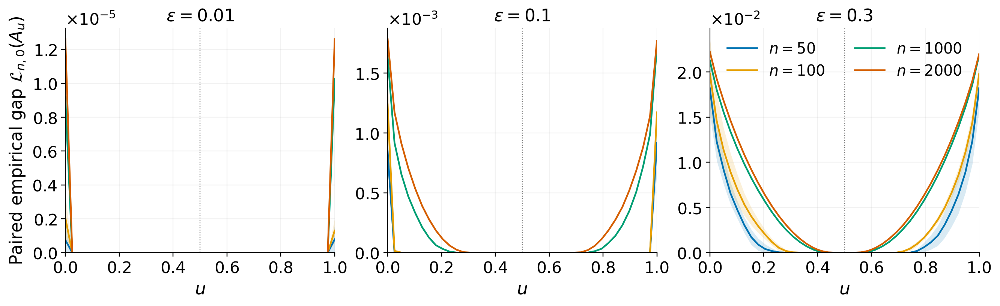

# Inverse optimal transport: the geometry of the gap

**Publication figures · exact assignment solvers · exploratory notebooks · interactive experiments**

Numerical companion to **Second-order geometry of optimal transport: cost identifiability and stability**, by Gabriel Peyré, Clarice Poon and Oscar Tron.

How can an optimal pairing identify the cost that generated it? These experiments contrast a degenerate Gaussian baseline, a convex gradient perturbation, and a radial transport to an annulus. They show how population identifiability can coexist with a finite-sample zero plateau.



## Start here

| You want to… | Open / run |
|---|---|
| Browse the project, figures, notebooks and demo from one page | [Website guide](docs/README.md); the homepage is `docs/index.html` |
| Read the mathematical setup and experiment settings | [Figure guide](figures/README.md) |
| Re-render all article figures from the included raw data | `python figures/reproduce.py --render-only` |
| Recompute the full article experiments | `python figures/reproduce.py --workers 4` |
| Explore maps, perturbations, and δ² rescaling | [Notebook 01](notebooks/01_models_and_gap.ipynb) |
| Compare true-plan pairs with independently matched clouds | [Notebook 02](notebooks/02_sampling_and_plateaus.ipynb) |
| Inspect the full-size data and publication assets | [Notebook 03](notebooks/03_article_data_and_figures.ipynb) |
| Move the points and cost sliders in your browser | [Interactive demo](docs/demo.html), served locally or deployed with GitHub Pages |

The repository contains the code, data and mathematical specifications needed to reproduce all four article figures.

## Install and reproduce

Use **Python 3.12** for the recorded numerical environment:

```sh
git clone https://github.com/gpeyre/iot-curvature.git
cd iot-curvature
python -m venv .venv
source .venv/bin/activate
python -m pip install -r requirements-lock.txt
python -m pip install -e .
python figures/reproduce.py --render-only
```

On Windows activate with `.venv\Scripts\activate`. A normal `python -m pip install -e .` also installs the supported dependencies; the lock file records the exact NumPy, SciPy and Matplotlib versions used for the committed data.

To recompute missing experiments from the deterministic samples:

```sh
python figures/reproduce.py --workers 4
```

Each completed experiment is cached separately, so interrupted computations can resume. To recompute a cached task, remove that task's `.npz` file from `figures/data/` and rerun. To recompute everything, move the existing data directory aside first. The complete run includes repeated dense assignments up to **n = 2000** and is substantially slower than rendering the included results. `--quick` creates clearly labeled reduced-size previews in `figures/preview/`.

Outputs are vector **PDF and SVG**, plus PNG previews. The samples, exact evaluated loss values, assignment permutations for Figure 4, long-form CSV, parameter specifications, software versions, and checksums are in [`figures/data/`](figures/data/). See [`manifest.json`](figures/data/manifest.json).

## The experiment in equations

For the bilinear cost and normalized matrix slice,

$$c_A(x,y)=-x^\top Ay,\qquad A(u)=\begin{pmatrix}u&0\\0&1-u\end{pmatrix},\quad 0\leq u\leq1.$$

The article draws genuine paired observations $X_i\sim\mathcal N(0,I_2)$, $Y_i=T(X_i)$ and plots the **mean unregularized gap**

$$L_n(u)=\max_{\sigma\in\mathfrak S_n}\frac1n\sum_i X_i^\top A(u)Y_{\sigma(i)}-\frac1n\sum_i X_i^\top A(u)Y_i.$$

Both maps are gradients of convex potentials and make the identity pairing optimal at $u=1/2$. The two maps are

$$T_\delta(x)=x-\delta\begin{pmatrix}\sin x_1+\sin(x_1+x_2)\\\sin x_2+\sin(x_1+x_2)\end{pmatrix},\qquad 0\leq\delta<\tfrac13,$$

and

$$T_{\rm ann}(x)=\frac{x}{\lVert x\rVert}\sqrt{a^2+(b^2-a^2)(1-e^{-\lVert x\rVert^2/2})},\qquad a=0.8,\quad b=0.85.$$

The second map is defined almost everywhere; its arbitrary value at the Gaussian-null point $x=0$ is documented in the implementation. The perturbation is called **ε in the article** and **δ in the exploratory controls**; these are the same parameter. It is never an entropic regularization parameter here.

All assignment values use the exact combinatorial problem, up to floating-point arithmetic. Rank-one endpoints are solved by sorting, with objective equivalence checked against assignment. There is **no entropic regularization**. Lines join evaluated grid nodes, so the figures do not claim to enumerate every intervening assignment breakpoint. Bands show mean ± one empirical standard deviation, not confidence intervals.

For δ = 0 the paired loss vanishes on the whole PSD slice for every n. Positive δ changes the population compatibility set, while each finite injective-map sample retains a zero plateau. Dividing by δ² can reveal the loss's small vertical scale; it preserves that plateau. A visibly flat small-δ curve is not by itself a numerical precision failure.

## Four article figures

| Figure | Reproducible output | Content |
|---|---|---|
| 1 | [`figure_1_cycles.pdf`](figures/generated/figure_1_cycles.pdf) | Three feasible support-cycle exchanges; the corresponding [TikZ source](figures/source/discrete_identifiability_cycles.tex) is included |
| 2 | [`figure_2_cosine.pdf`](figures/generated/figure_2_cosine.pdf) | ε = 0.01, 0.1, 0.3; n = 50, 100, 1000, 2000; five repetitions for the two small n, one for the two large n |
| 3 | [`figure_3_annulus.pdf`](figures/generated/figure_3_annulus.pdf) | Gaussian-to-annulus paired gaps; the same four n, five repetitions each |
| 4 | [`figure_4_annulus_maps.pdf`](figures/generated/figure_4_annulus_maps.pdf) | All 1000 empirical assignment arrows at u = 0.5, 0.9, 0.1, on one fixed paired sample from the same annulus model |

The [figure guide](figures/README.md) specifies every seed, evaluation grid and repetition count. Figure 4 uses the same paired sample as the first repetition of the n = 1000 annulus loss experiment, making its assignments directly comparable with Figure 3.

## Explore in Jupyter

```sh
python -m pip install -e '.[notebooks]'
jupyter notebook notebooks/
```

The notebooks find this repository from their own location. They run quickly at modest n; the third reads the committed large-n results. Optional widgets allow changes to n, δ, the model and seed. To execute every notebook without opening a server:

```sh
python scripts/check_notebooks.py
```

## Project website and interactive demo

The repository includes a project homepage that introduces the paper and gives direct access to the interactive demo, publication figures, exploratory notebooks and source code on GitHub. The homepage and demo are static files: **no installation, backend or build step is required**.

To preview the site from the repository root:

```sh
python -m http.server 8000 --directory docs
```

Open **http://localhost:8000/** for the homepage, or **http://localhost:8000/demo.html** for the demo. The demo includes linked point clouds and gap curves, the cost slider, point count and perturbation controls, new samples, reference pairs, a δ² scale option, and a comparison of **true-plan pairs** with an **empirical OT reference between independent marginal samples**. Exact Hungarian assignments run in a worker so the controls remain responsive. No external CDN is used.

The browser uses smaller samples and its own documented random generator. It explores the same mathematics; its random clouds are not the article samples. See [interactive documentation](docs/README.md).

To publish the site after uploading this repository:

1. Open **Settings → Pages** on GitHub.
2. Under **Build and deployment**, choose **Deploy from a branch**.
3. Select **`main`** and **`/docs`**, then click **Save**.
4. Wait for GitHub's Pages deployment to finish; the Pages settings show its status and published URL.

The intended homepage URL is **https://gpeyre.github.io/iot-curvature/**, and the demo URL is **https://gpeyre.github.io/iot-curvature/demo.html**. These URLs become available after Pages has been enabled and deployment succeeds. Subsequent pushes to `main` update the site automatically. All required site assets are committed in `docs/`; uploading the repository is sufficient. The site supports project subpaths. The demo is inspired by [Gabriel Peyré's interactive gap-loss post](https://www.gpeyre.com/blog/2026/10/03/inverse-optimisation-gap-loss/).

## Checks and manuscript integration

The JavaScript checks use **Node.js 24**, as recorded in the GitHub workflow. From the installed Python environment, run:

```sh
python -m unittest discover -s tests -v
python scripts/check_data.py
node docs/test_math.mjs
python scripts/check_browser_math.py
python scripts/check_site.py
```

The checks cover brute-force small assignments, the loss sign and 1/n normalization, zero baseline and true-cost gaps, convexity, the radial CDF, seeds, committed-data integrity, and agreement between browser and SciPy objectives. The GitHub workflow runs the numerical tests and notebook execution; it does not rerun the expensive full experiment on every push.

To install the generated PDFs into a manuscript checkout:

```sh
python scripts/update_manuscript_figures.py --paper /path/to/iOT_JEMS_revised
```

This copies the four publication PDFs to `Pictures/generated/` in the chosen manuscript directory and records their matching checksums. The resulting files can be included directly from LaTeX.

## Repository map

```text
src/iot_gap/       Shared Python maps, sampling, assignments and gap
figures/          Exact article protocol, raw data and vector exports
notebooks/        Three guided explorations
docs/             Project homepage, interactive demo and site assets
tests/            Mathematical and numerical invariants
scripts/          Notebook, data, browser and manuscript checks
```

Citation metadata is provided in [CITATION.cff](CITATION.cff).

## License

The numerical companion is released under the [MIT License](LICENSE).
